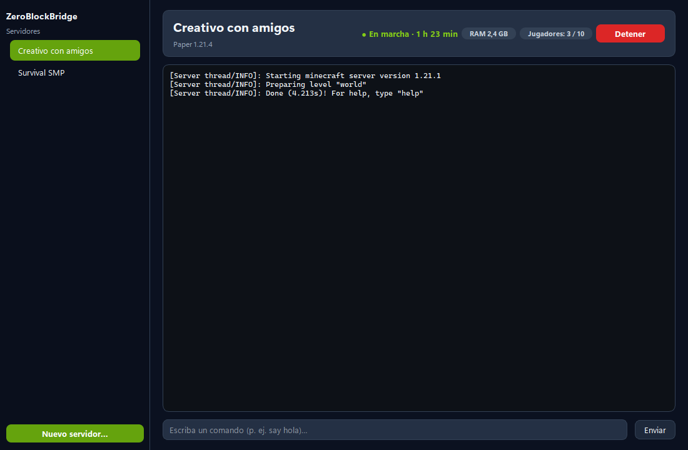
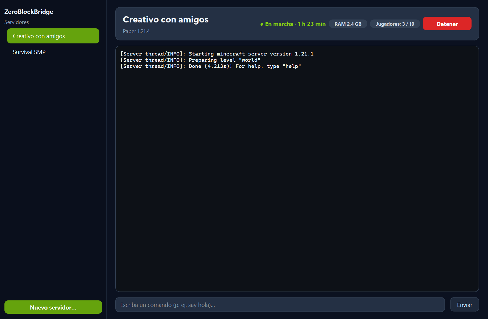
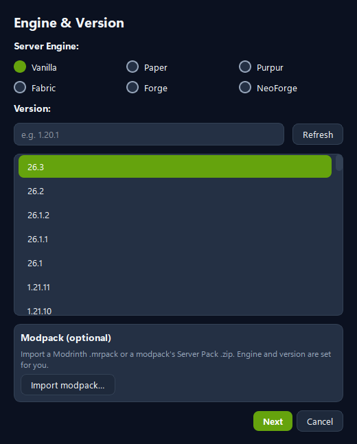
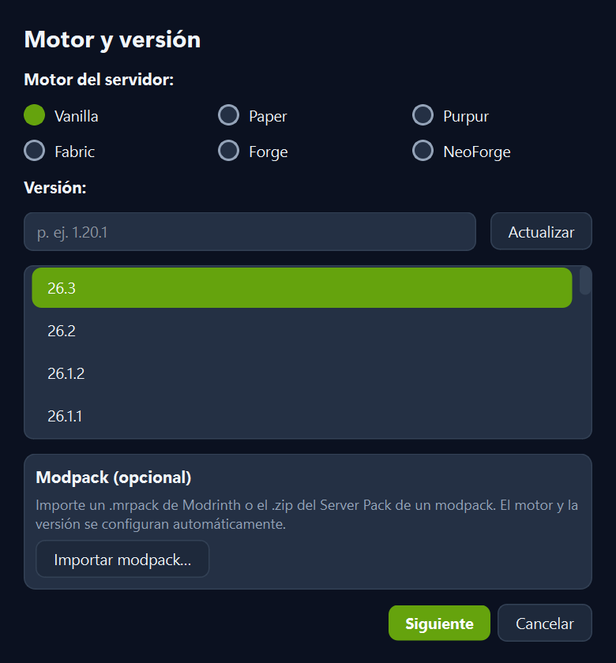
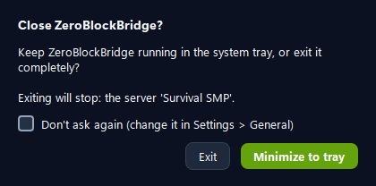
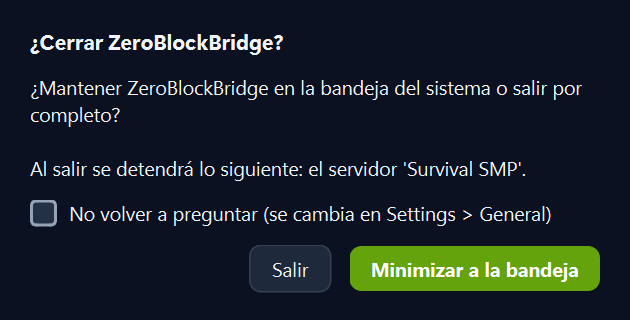
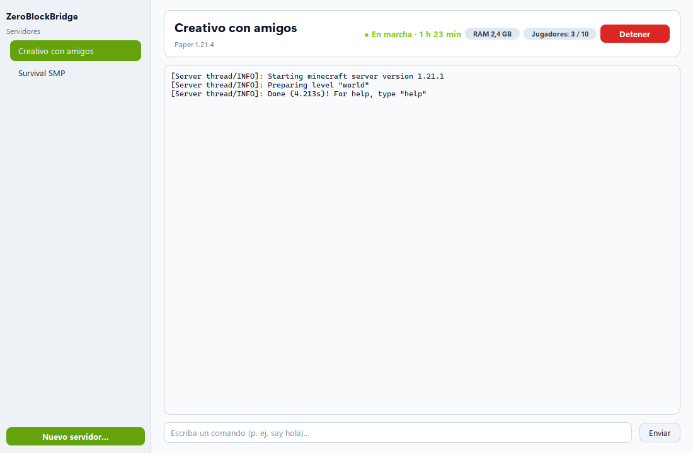
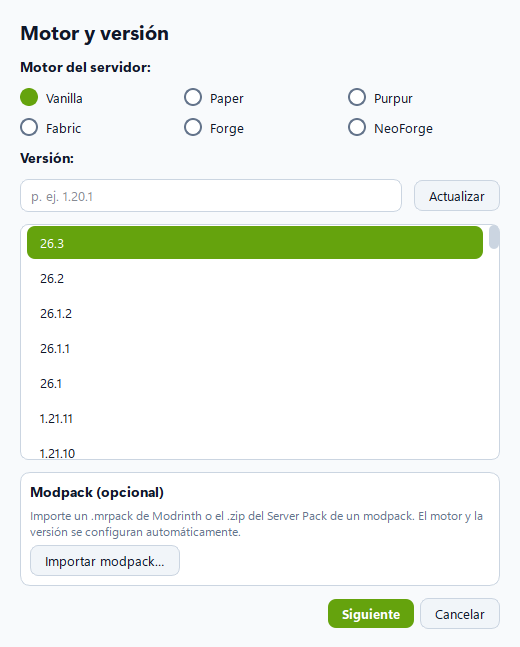

# Qt spike (roadmap 8c): result

**Recommendation: GO, with conditions** (listed under [Recommendation](#recommendation)). The PySide6 slice passed all four criteria on this machine. It opens dialogs 4–10× faster than CustomTkinter, with no white flash. It starts about 0.9 s faster than the CustomTkinter exe. The exe is 31 MiB against 23 MiB.

Run on 2026-10-18 on the owner's Windows 11 Pro 10.0.26200 machine (display at 100 %, 96 DPI). Software: Python 3.14.2, PySide6-Essentials 6.12.0, PyInstaller 6.22.3 (CI pins 6.20.0). Branch `spike/qt`, cut from `dev` at `8312c77`.

## What was built

The slice lives in `app/ui_qt/`, about 900 lines, and runs with `py app/launcher.py --ui=qt`. CustomTkinter stays the default. The slice reaches the core only through `app/api`. Two kinds of imports are allowed besides that:
- the core's presentation modules (`app_config`, `i18n`, `resources`);
- `app.ui.formatting` (pure helpers shared with the current UI).

As with the current UI, `main()` is the documented exception. `tests/test_ui_qt.py` enforces these rules.

| File | Lines | What it does |
|---|---|---|
| `dispatcher.py` | 40 | `QtDispatcher`: a signal connected with `Qt.QueuedConnection`. It posts every API callback to the GUI thread, the same contract as Tk's `after(0)`, and drops calls once Qt is gone. |
| `main_window.py` | 428 | Server list and a live header: state, uptime, RAM every 3 s, players and Start/Stop. Also the console and command input with history, the close-to-tray choice (same `close_action` setting and strings as the current dialog) and the `QSystemTrayIcon` menu (Open / Exit). Exit shuts the API down off the GUI thread with an 8 s deadline. |
| `console.py` | 46 | `QPlainTextEdit` capped at 1,000 blocks. Lines are batched every 50 ms and the view follows the end only while the user is at the bottom. |
| `wizard.py` | 186 | Engine & Version dialog: the six engines including NeoForge, a version list from `api.creation.versions` (on a worker), search, Refresh, and modpack import through `api.creation.inspect_modpack`, which locks the engine. |
| `theme.py` | 131 | Fusion style, plus a QPalette and QSS built from the `AppConfig` `COLOR_*`/`FONT_*` tokens, for dark and light. `styleHints().setColorScheme()` also switches the native title bar, so there is no DWM code. |
| `app.py` | 85 | Startup in the same order as `app/ui/main.py`: logging, settings, language, single-instance lock, EULA check, API, window, background services. Adds `--lang=xx` / `--theme=X` overrides for this spike. |

**Spanish uses the same gettext catalog.** Every string in the slice goes through `_()`. Where the current UI already had a string (the close dialog, tray texts, "Running · {elapsed}"…), the slice uses the same msgid. 28 new strings were translated in `assets/locales/es/LC_MESSAGES/zbb.po` (formal "usted") and the `.mo` was recompiled. Qt Linguist is not used, and Qt's own `.qm` files are left out of the exe.

**Packaging and other changes:**
- `packaging/qt_spike.spec` plus `packaging/qt_spike_entry.py` build the Qt exe.
- PySide6 is listed only in `requirements-qt.txt`.
- `ZeroBlockBridge.spec` and `linux.spec` now exclude `app.ui_qt`, `PySide6` and `shiboken6`, so the release exe cannot pick Qt up.
- The measurements are reproducible with `tools/qt_spike_bench.py`. Raw numbers are in [`assets/qt-spike/results.json`](assets/qt-spike/results.json).

## Criteria

| Criterion | Target | Qt result | Verdict |
|---|---|---|---|
| Dialog open time | < 100 ms, no white flash | Engine & Version: **63–74 ms** the first time, **26–37 ms** after that (median). Close choice (the confirm dialog): **14–32 ms**. Baseline: CustomTkinter Server Properties ~370 ms, confirm dialogs ~120 ms. No frame of the dialog was ever white. | **PASS** |
| Exe size | ≤ 60 MB | **30.9 MiB** (32.4 MB) one-file PyInstaller. A CustomTkinter exe built the same way is 23.0 MiB. That is +7.9 MiB, about +34 %. | **PASS** |
| Startup | ≤ current + 1 s | Median of 5: Qt **1,538 ms**, CustomTkinter **2,410 ms** (−872 ms) | **PASS** |
| 150 % scaling + Spanish | correct | All texts fit in es and en at 100 % and 150 %, with no clipping or overlap (see the screenshots). Caveat: 150 % was set with `QT_SCALE_FACTOR=1.5`, not by changing the Windows display setting. | **PASS** (caveat below) |

### How each number was measured

**Dialog open time** (`qt_spike_bench.py inproc`):
- **What is timed:** `QElapsedTimer` runs from the call that builds the dialog until the event loop is idle again after the dialog's first `Paint` event. The time therefore covers construction, `show()`, and painting and flushing every child widget. Windows composites the window up to one more vsync (~16 ms) later.
- **Runs:** 10 openings per dialog, in 5 configurations: en/es × 100/150 %, plus light theme.
- **First-opening numbers:** 71.9 (en 100 %), 74.2 (en 150 %), 63.0 (es 100 %), 65.3 (es 150 %) and 62.1 ms (light).
- **Warm medians:** 36.9 / 28.9 / 26.3 / 28.5 / 29.5 ms. The worst single run was 74.2 ms.
- **What is not timed:** the version list loads on a worker after the dialog is shown.

**White flash:**
- **Method:** a thread called `PrintWindow(PW_CLIENTONLY | PW_RENDERFULLCONTENT)` on the dialog's own window, from the moment its native window existed until 500 ms after `show()`. That gave 24–31 frames per opening, 3 openings per configuration. It captures only that window, never the desktop.
- **Qt result:** in dark mode no frame had any near-white pixels (max share 0.0). In light mode no frame was whiter than the final one. Qt's window class has no background brush (`GCLP_HBRBACKGROUND = 0`), so Windows has nothing to erase with before the first paint.
- **Control:** the same probe on a plain dark `CTkToplevel` (`qt_spike_bench.py ctkflash`) caught a **100 % white frame in each of 3 openings**. So the method does detect the flash CustomTkinter is known for.

**Exe size:**
- **Builds:** `pyinstaller packaging/qt_spike.spec` and `pyinstaller packaging/ZeroBlockBridge.spec`, from the same venv (Python 3.14) on this machine.
- **What the Qt build leaves out:**
  - `opengl32sw.dll` (~20 MB), the software OpenGL fallback;
  - QtNetwork/Qml/Quick/Pdf/Svg/OpenGL;
  - Qt's translations;
  - unused image-format plugins and the `qdirect2d` platform plugin;
  - Pillow's AVIF codec.
- **Before trimming:** the first, untrimmed attempt was 37.4 MiB.
- **Where the size is now:** `Qt6Core` 10.0, `Qt6Gui` 9.2, `Qt6Widgets` 6.2 and the three PySide6 bindings 11.8 MiB, uncompressed.

**Startup** (`qt_spike_bench.py startup`):
- **What is timed:** from `Popen` until `EnumWindows` sees a visible "ZeroBlockBridge" window owned by the exe's process tree (bootloader plus child). Each process was then killed and the next run waited 2 s.
- **Data folder:** each exe ran in portable mode (a `ZeroBlockBridge-portable.txt` flag next to it) with its own small data folder, so the owner's install and data were never touched.
- **Runs:** Qt 1,450 / 1,447 / 1,538 / 1,855 / 1,669 ms; CustomTkinter 2,410 / 2,315 / 2,643 / 2,553 / 2,154 ms.
- **Why not the v2.3.0 release exe:** the CustomTkinter baseline was built locally from this branch instead of being downloaded. Building both from the same Python and the same source keeps the comparison fair. The release exe is built with Python 3.11 in CI, so its absolute times may differ slightly.

**Clean exit:** WM_CLOSE with `close_action = exit`. The packaged Qt exe ended with exit code 0 in 0.97 s.

## Other observations

| Topic | Result |
|---|---|
| **Memory** | **Packaged exes, 3 s after the window shows:** 48 MB USS for the whole process tree in both cases (Qt 48.1–48.7, CustomTkinter 47.8–48.3). **In-process from source:** 93–99 MB RSS idle and 108–121 MB after the console bursts. That includes the Python interpreter, the full core and the API. |
| **Console under fast output** | **What was sent:** lines emitted on the real `EventBus` from a worker thread, as the server reader does, then dispatched through `QtDispatcher`. **2,000-line burst:** every line delivered and shown in **65–90 ms**; the GUI loop never stalled more than **21 ms**. **20,000-line burst:** 480–650 ms, worst stall 84 ms. **Cap:** the view keeps the last 1,000 lines. The current console inserts each line with its own Tk text insert and trim, with no batching. |
| **Tray** | **Checked:** `QSystemTrayIcon.isSystemTrayAvailable()` is True. Hiding to the tray hides the window and shows the icon with the menu "Open ZeroBlockBridge / Exit". Open restores the window and hides the icon. **Effect on the exe:** pystray is no longer needed. |
| **Code size** | **Qt:** about 900 lines in `app/ui_qt`. **CustomTkinter, same features (estimate):** about 1,800 lines. Of `main.py`, the sidebar, header, console, status tick, close and tray parts are ~600 lines. The rest is `ConsoleWidget` (~190), `ServerListItem` (~175), `close_dialog.py` (97), `tray.py` (98), the wizard's engine and version step (~250), and the workarounds Qt doesn't need: `hide_until_drawn`/`ZBBToplevel` (~150) and `win_effects.py` (227). |
| **Theme** | One QSS generated from the existing tokens covers both modes; the screenshots are below. **Gap:** the light theme shows that `COLOR_STATUS_ONLINE` (lime-400) has low contrast on white. That token is the same in the current UI, so it is not a Qt problem. |

### Screenshots

Every screenshot was taken with `QWidget.grab()`, which renders the app's own widgets. Nothing else on the desktop can appear in them, and window title bars are not included. The "running" header is simulated (no server was started) to show its longest texts.

| | en | es |
|---|---|---|
| Main, 100 % |  |  |
| Main, 150 % |  |  |
| Engine & Version |  (100 %) |  (150 %) |
| Close choice |  (100 %) |  (150 %) |
| Light theme (es, 100 %) |  |  |

## What was hard / risks

1. **150 % was emulated.** `QT_SCALE_FACTOR=1.5` makes Qt lay out and render exactly as it would at 150 %, and Qt 6 is per-monitor-DPI-aware by default. Still, the real case was not run: a 150 % Windows setting, or moving the window between monitors with different scaling. Changing the owner's display settings was out of scope. This should be checked by hand on the first 8d PR.
2. **First-run, setup and uninstall dialogs are Tk.** `bootstrap.resolve_data_dir()` opens `app/ui/first_run_dialog.py`, and the spike exe excludes tkinter. So a Qt exe would fail on a machine with no install marker. These dialogs must be ported to Qt before tkinter can leave the exe; they can move into an earlier 8d step. The EULA dialog is not ported either: the slice asks the user to accept it in the regular window first.
3. **Nuitka was not tried.** For Python 3.13+, Nuitka needs MSVC on Windows; only MinGW is installed here, and installing Build Tools was out of scope. PyInstaller already meets the size target, so Nuitka is optional and only worth trying for startup.
4. **No real server was started.** Doing that from the slice would have meant downloading a JDK and touching the owner's servers. The live path (events → dispatcher → widgets) was exercised with the real `EventBus` and `AppApi`, and Start/Stop call the same `api.servers.start/stop` as the current UI. The first 8d PR should run a real start → console → stop.
5. **Exe +8 MiB and Linux not built.** The Linux build was not tried: it needs the `xcb` platform plugin and `libxkbcommon`/`libxcb-cursor`, which may need runner packages. Do this early in 8d.
6. **LGPL.** PySide6 and Qt are LGPLv3. They are linked dynamically (separate DLLs inside the one-file exe), which is the usual way to comply. 8d must add the Qt/PySide6 notices to the third-party licenses and to About.
7. **Things that took time:**
   - **Toolkit pitfalls:**
     - With Fusion dark, `QRadioButton` and `QCheckBox` indicators were invisible until styled in QSS.
     - Property-driven QSS (status colour, Start↔Stop) needs `unpolish`/`polish` when the property changes.
   - **Bench-only problems:**
     - `PrintWindow` from a worker deadlocks if the GUI thread stops pumping messages.
     - The bench process can segfault inside `os._exit` while Qt and API threads are still alive; the app's own exit path was clean.
8. **Shared helpers.** `app.ui.formatting` (durations, RAM) is shared by both UIs. Move it to a toolkit-neutral place, such as `app/core` next to `i18n`, when 8d starts.

## Recommendation

**GO with conditions.** The point of the migration was dialogs that open slowly and flash white. Qt fixes that with an order-of-magnitude margin and no workarounds, starts faster, uses the same memory, and stays well under the size limit. The pywebview fallback is not needed.

Conditions:
- **(a)** Check real 150 % and mixed-DPI scaling by hand on the first 8d PR.
- **(b)** Port first-run, setup, uninstall and EULA to Qt before dropping tkinter.
- **(c)** Get the Linux one-file build green in CI early, together with a release-shaped Windows build on Python 3.11.
- **(d)** Add the LGPL notices.

### Proposed 8d order and estimate

Each step is one PR behind `--ui=qt`, with its Spanish strings, CustomTkinter staying the default until parity.

| # | Group | Estimate |
|---|---|---|
| 1 | Harden the slice: real server start/stop, console search/filter, Playit tunnel controls and log tab, notifications/toasts, window-state persistence. Move `formatting` to a neutral module. Qt build job in CI (Windows + Linux). | 3 days |
| 2 | Server list actions (create/import/export/delete menus, status pills) and the header's remaining parts (address, players badge → panel) | 2 days |
| 3 | First-run/setup/uninstall/EULA dialogs (needed to drop tkinter) | 2 days |
| 4 | Full server wizard (the remaining steps, templates, worlds, progress dialog with `Task`) | 3 days |
| 5 | Server properties editor (tabs from `property_catalog`, backups, schedule, Java/launch settings) | 4 days |
| 6 | App settings | 2 days |
| 7 | Players panel (heads, whitelist/ops/bans) | 2 days |
| 8 | Modrinth browser (search, icons, versions, installs, updates) | 4 days |
| 9 | Parity pass, make Qt the default, remove CustomTkinter/pystray/win_effects, release build | 2 days |

**Total: about 24 working days (~5 weeks)** of focused work, plus review time. Steps 3 and 6–8 are independent of each other once step 1 has landed, so they can run in parallel sessions.
